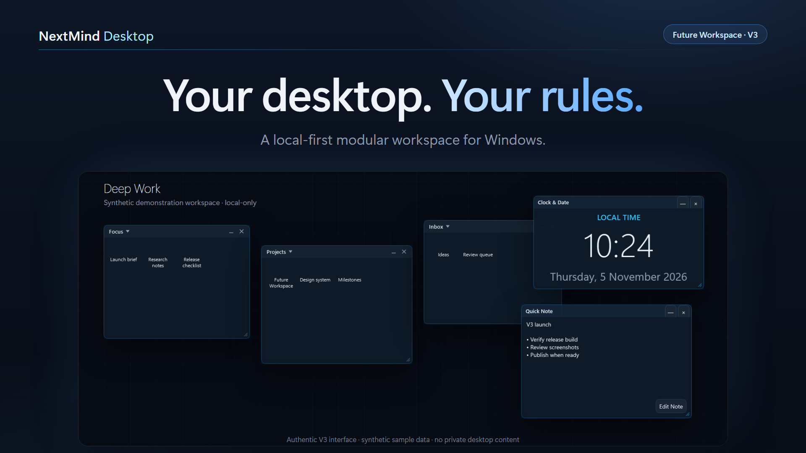
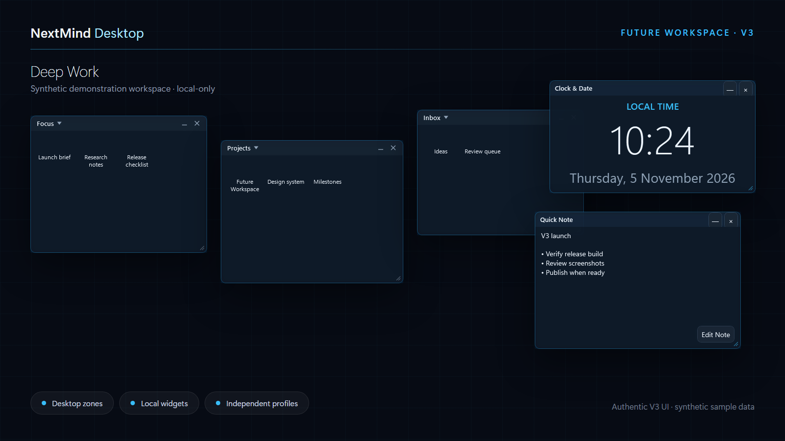
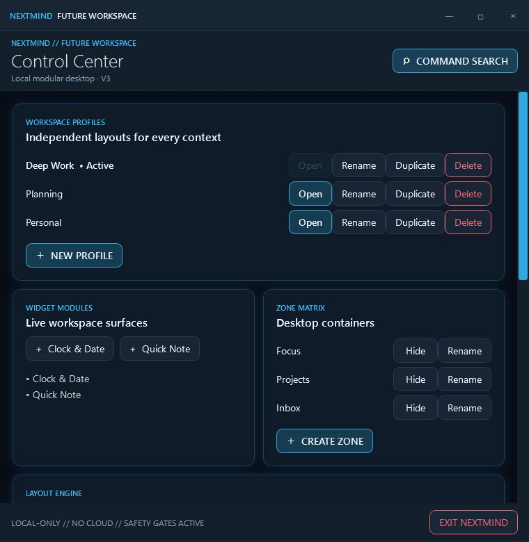
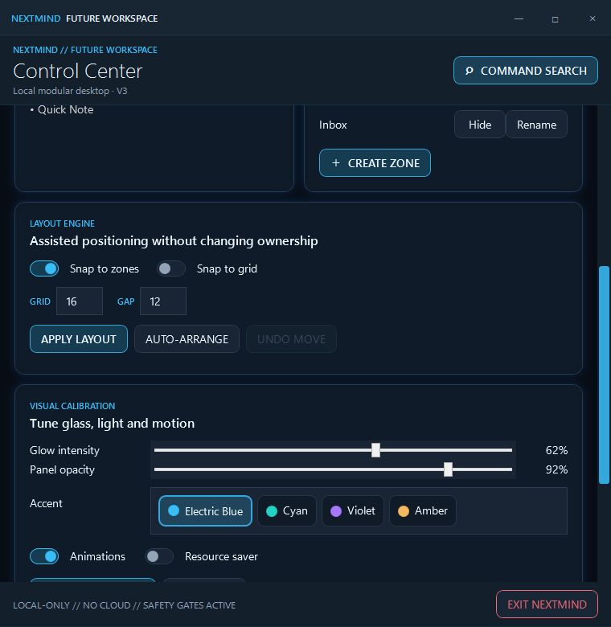

# NextMind Desktop

<p align="center">
  
</p>

<p align="center">
  <strong>Your desktop. Your rules.</strong><br>
  A local-first workspace for Windows that turns desktop clutter into calm, configurable zones.
</p>

<p align="center">
  <a href="https://github.com/NextMindHQ/nextmind-desktop/releases"></a>
  
  <a href="LICENSE"></a>
  <a href="https://github.com/NextMindHQ/nextmind-desktop/actions"></a>
</p>

NextMind Desktop lives between your wallpaper and your applications. It provides collapsible zones, local search, workspace profiles and lightweight widgets without an account, cloud service, telemetry or ads. Your configuration stays on your computer, and the guarded file model never deletes or overwrites your files.

> **V3.0.0 release candidate.** The presentation below documents the completed V3 build. Download links will become active when the audited release is published.

## Future Workspace in V3

- **A cohesive new interface** — custom window chrome, holographic surfaces and a restrained accent system across the desktop and Control Center.
- **Zones that stay useful** — expand, collapse, reorder and calibrate work areas while keeping applications above them.
- **Search inside every zone** — filter names live with case- and diacritic-insensitive matching, keyboard selection and a non-destructive empty state.
- **Placement that helps without taking over** — new zones seek free space, snap to neighbouring edges, and can still overlap intentionally.
- **Smarter expanding and menus** — zones choose the less obstructive expand direction; context menus and submenus stay on-screen and close on focus loss.
- **Profiles for every context** — switch between focused layouts without losing zone, widget or note state.
- **Local command search** — find NextMind commands, zones, widgets and Start-menu applications with `Ctrl+K`.
- **Useful, quiet widgets** — responsive Clock & Date and Quick Note widgets, persisted per profile.
- **Live personalization** — preview opacity, glow and accent changes immediately; Apply commits them and closing rolls back unapplied changes.
- **Safety by design** — managed desktop moves remain opt-in, journalled and recoverable; referenced files stay where they are.

## Gallery

### One workspace, arranged around you



<table>
  <tr>
    <td width="50%"></td>
    <td width="50%"></td>
  </tr>
  <tr>
    <td align="center"><strong>Control Center</strong><br>Profiles, zones, widgets and local search in one place.</td>
    <td align="center"><strong>Personalization</strong><br>Immediate preview with explicit Apply and rollback semantics.</td>
  </tr>
</table>

All product views above come from an isolated V3 demonstration profile with synthetic data. No personal desktop, path, filename or user configuration is shown.

## Install or update

1. Open [GitHub Releases](https://github.com/NextMindHQ/nextmind-desktop/releases) and choose **NextMind Desktop V3.0.0**.
2. Download `NextMindDesktop-3.0.0-Setup.zip` and extract it to a temporary folder.
3. Exit NextMind Desktop normally from its tray menu. The installer never terminates the app for you.
4. Run `INSTALL-V3.cmd` and follow the prompts.
5. Start NextMind Desktop from the Start menu.

The setup package validates every payload file before installation, makes a verified pre-upgrade backup, and replaces only the application directory at `%LOCALAPPDATA%\NextMind\Desktop\app`. Configuration, profiles, notes, managed items, logs and the existing autostart preference remain in place. A rollback script is included; see [Update guide](docs/UPDATE-V3.md) and [Rollback guide](docs/ROLLBACK-V3.md).

> Setup is a script bundle inside a ZIP, not an MSI. The installed build requires the [.NET 8 Desktop Runtime for Windows x64](https://dotnet.microsoft.com/download/dotnet/8.0).

## Portable edition

Download `NextMindDesktop-3.0.0-Portable-win-x64.zip`, extract the complete archive, and run `NextMindDesktop.exe`. The portable build is self-contained and does not require a separate .NET runtime.

Portable mode is deliberately isolated from the installed edition:

- it stores configuration in `%LOCALAPPDATA%\NextMind\Desktop-Portable`;
- it never registers autostart or an uninstaller;
- it does not read or change `%LOCALAPPDATA%\NextMind\Desktop`;
- moving the executable without its `NextMindDesktop.portable` marker disables portable detection, so keep the archive contents together.

## Requirements

- Windows 10 version 2004 or newer, or Windows 11
- x64 processor
- .NET 8 Desktop Runtime for the Setup edition; no separate runtime for Portable
- Standard user account; administrator rights are not required

To build from source, install the .NET 8 SDK selected by `global.json`.

## Build and test

```powershell
dotnet restore
dotnet build -c Release
dotnet test -c Release
```

The test suite uses guarded temporary directories and must never target Desktop, Documents, Pictures, OneDrive or live application data.

## Data and privacy

- No account, network service, telemetry or advertising.
- Configuration and logs remain under the selected local data root.
- Files outside NextMind's guarded storage are referenced, not relocated.
- Optional managed moves accept only loose user-Desktop items, use write-ahead journalling and never overwrite an existing destination.
- Uninstalling the application does not delete user data automatically.

Read the detailed model in [Threat and data safety](docs/THREAT-AND-DATA-SAFETY.md).

## FAQ

<details>
<summary><strong>Does NextMind replace Windows Explorer or the desktop?</strong></summary>

No. It adds a local workspace layer above the wallpaper and desktop icons but below normal application windows.
</details>

<details>
<summary><strong>Can it delete or overwrite my files?</strong></summary>

No. References never move files. The optional managed-move feature is off by default, accepts only eligible Desktop items, journals the operation and refuses destination collisions.
</details>

<details>
<summary><strong>Will an update erase my layout or notes?</strong></summary>

The V3 installer preserves the complete data area and replaces only the versioned application payload. It also creates and verifies a backup before switching versions.
</details>

<details>
<summary><strong>Can installed and Portable editions coexist?</strong></summary>

Yes. They have separate data roots. Do not run two instances at the same time unless you are using the project's explicitly isolated test mode.
</details>

<details>
<summary><strong>Where can I report a problem?</strong></summary>

Use [GitHub Issues](https://github.com/NextMindHQ/nextmind-desktop/issues) and include the Windows version, package type and reproduction steps. Never attach private configuration or personal files.
</details>

## Project layout

```text
src/NextMind.Desktop.Core    Configuration, profiles, search, widgets and guarded filesystem logic
src/NextMind.Desktop.Shell   Windows desktop integration and single-instance infrastructure
src/NextMind.Desktop.App     WPF zones, widgets and Control Center
tests/                       xUnit and release-package verification
tools/                       Build, launch, packaging and recovery tools
docs/                        Architecture, safety, update and release documentation
marketing/                   Public presentation assets and reproducible visual sources
```

See the [changelog](CHANGELOG.md), [V3 release notes](docs/RELEASE-NOTES-V3.md), [security policy](https://github.com/NextMindHQ/nextmind-desktop/blob/main/SECURITY.md) and [contributing guide](https://github.com/NextMindHQ/nextmind-desktop/blob/main/CONTRIBUTING.md).

## License

NextMind Desktop is licensed under [Apache License 2.0](LICENSE). Third-party projects mentioned in the research documents were studied for ideas only; no source code was copied. The license does not grant rights to the NextMind name or branding.
