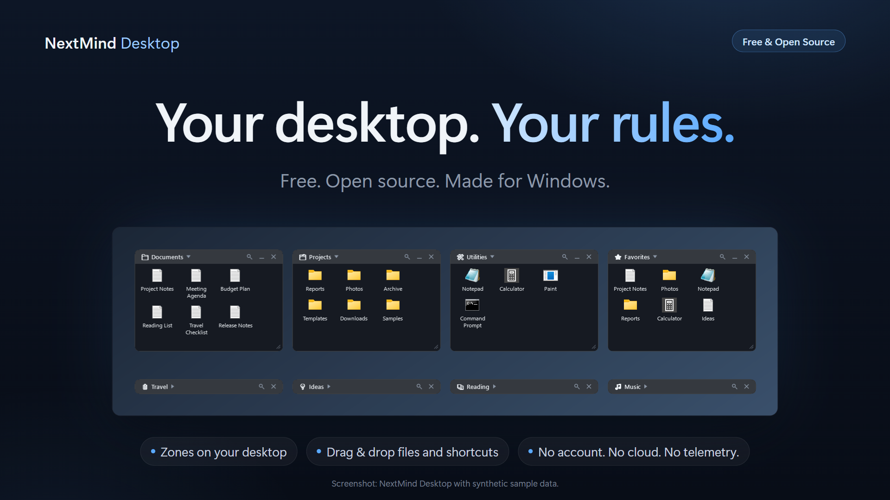
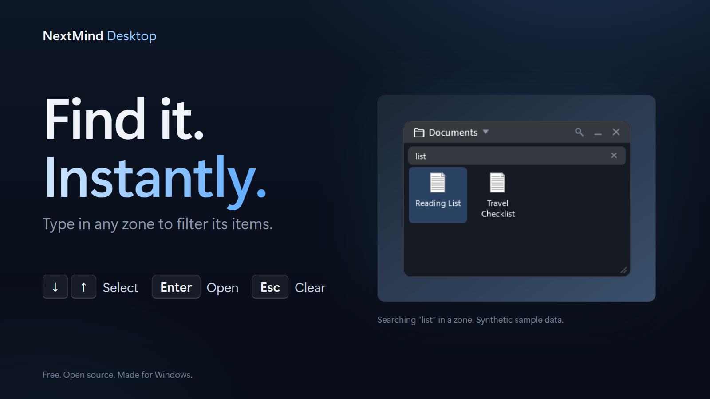

<p align="center">
  
</p>

<h1 align="center">NextMind Desktop</h1>

<p align="center">
  <b>Your desktop. Your rules.</b><br>
  A free, open-source desktop organizer for Windows.
</p>

<p align="center">
  <a href="https://github.com/NextMindHQ/nextmind-desktop/releases/latest"></a>
  <a href="#requirements"></a>
  <a href="LICENSE"></a>
  <a href="https://github.com/NextMindHQ/nextmind-desktop/actions/workflows/ci.yml"></a>
</p>

<p align="center">
  <a href="https://github.com/NextMindHQ/nextmind-desktop/releases/latest"><b>⬇ Download v0.1.0</b></a> &nbsp;·&nbsp;
  <a href="#coming-in-v020">What is coming in v0.2.0</a> &nbsp;·&nbsp;
  <a href="docs/USER-GUIDE.md">User guide</a> &nbsp;·&nbsp;
  <a href="CHANGELOG.md">Changelog</a>
</p>

<p align="center"><sub>The screenshot shows the interface being prepared for v0.2.0 — note the magnifier in each title bar: search is <b>not</b> in the published v0.1.0.<br>
Synthetic sample data; screenshots never show a real desktop (<a href="docs/SCREENSHOT-PLAN.md">how they are made</a>).</sub></p>

## Why NextMind Desktop

The Windows desktop quickly turns into a pile of icons. NextMind Desktop gives it structure: you create named **zones** right on the desktop — above the wallpaper
and icons, below your applications — drop files, folders and shortcuts into them, collapse the ones you do not need, and carry on.

You decide the layout: no grid, no automatic arranging. It is a small, quiet tray application with **no account, no cloud and no telemetry**.

## Available now: v0.1.0

The current public release ([download](https://github.com/NextMindHQ/nextmind-desktop/releases/latest)) includes:

* **Desktop Zones** — named panels that live on the desktop itself, under your windows and over the icons
* **Collapse / expand** a zone to just its title (double-click the title bar); **move and resize** it freely, it stays within the visible monitor area
* **Drag & drop** files, folders and shortcuts from Explorer or the Desktop; the original is never touched
* **Sorting and manual ordering** — drag to reorder, or sort per zone by name, date added or type
* **Native Windows icons**, a **tray icon and Control Center**, and **Start with Windows**
* **Show desktop (Win+D)** reveals your zones; application windows cover them
* **Persistence** — positions, sizes, collapsed state, items and sort order survive restarts
* **Managed Desktop Moves** — *opt-in, off by default*; see [Safety](#managed-desktop-moves--safety)

## Coming in v0.2.0

> **In preparation, not released.** v0.2.0 is being prepared and is not published yet. Everything in this section is **not** in the download above.
> See the [changelog](CHANGELOG.md) for the full list.

<p align="center">
  
</p>

* **Search in every zone** — a magnifier in each title bar filters that zone's items as you type (names of files, folders and shortcuts; ignores case and Polish letters).
  **↓ / ↑** select, **Enter** opens, **Esc** clears. Searching never changes your zone or your files.
* **A layout that is yours, with some help** — new zones appear in a free spot; edges snap to neighbours while you drag (hold **Alt** to move freely); overlapping on purpose still works.
* **Smarter expanding** — a zone opens downward, or upward when that covers fewer other zones or would leave the screen. Other zones are never moved.
* **Menus that stay out of the way** — context menus and the *Sort by* / *Move to Zone* submenus open where they cover the least of neighbouring zones, and they close when you click elsewhere.
* **Fix:** a zone collapsed near the bottom edge of the screen no longer creeps upward at every start.

## Quick start & install (v0.1.0)

1. Download **`NextMind-Desktop-v0.1.0-win-x64.zip`** from the [latest release](https://github.com/NextMindHQ/nextmind-desktop/releases/latest).
2. Extract it to a folder you want to keep (the app registers that location for *Start with Windows*).
3. Run **`NextMindDesktop.exe`**.

A first Zone appears on your desktop and a tray icon is added. Drop files, folders or shortcuts onto the Zone. More in the [user guide](docs/USER-GUIDE.md).

* **Self-contained:** v0.1.0 includes everything it needs. **You do not need to install .NET.**
* **Not code-signed yet:** Windows SmartScreen may warn about an unrecognized app. If you trust the download, choose *More info* → *Run anyway*.
  You can check the file first: the release includes a `.sha256` file, or run
  `Get-FileHash .\NextMind-Desktop-v0.1.0-win-x64.zip -Algorithm SHA256` in PowerShell and compare it with the value on the release page.
* **Start with Windows is on by default** on the first run. Untick it in the tray menu if you don't want it.
* **Uninstall:** untick *Start with Windows* in the tray menu, choose *Exit*, then delete the folder you extracted the program to.
  Your data folder `%LOCALAPPDATA%\NextMind\Desktop` needs one more step first — see the warning below.

> **Warning — check before you delete `%LOCALAPPDATA%\NextMind\Desktop`.** If you ever turned on *Managed Desktop Moves*, the Desktop items you dropped onto a Zone were
> **moved** into `%LOCALAPPDATA%\NextMind\Desktop\ManagedItems`, so that folder can hold **your own files**, and the Desktop no longer has them.
> Give them back first: use *Return to Desktop* in each item's menu, or *Delete Zone* → *Return items to Desktop and delete Zone*. Then open `ManagedItems` and make sure it is
> empty or holds nothing you need. Only then delete the data folder (settings, logs and the journal). If you never enabled Managed Desktop Moves (the default), the folder holds only
> settings and logs and can be removed after you exit the app.

## How it works

Every item in a Zone is one of two kinds, decided by where it comes from:

| You drop… | Result |
|---|---|
| **Anything that is not directly on your Desktop** (other folders, drives, the Public Desktop, Desktop subfolders) | **Reference.** The Zone remembers the path; the original is never touched. "Remove from Zone" only forgets the path. |
| **A loose item from your Desktop** | Depends on the Managed Desktop Moves setting: **reference** while it is OFF (default), **moved** into managed storage when it is ON. |
| **Return to Desktop** (item menu) | Safely moves a managed item back to the Desktop. |

Your settings and the log live in `%LOCALAPPDATA%\NextMind\Desktop\` (`config.json`, `logs\desktop.log`). The log can contain the names of
files you drop onto a Zone — review it before attaching it to a bug report.

## Managed Desktop Moves / Safety

**Managed Desktop Moves are an opt-in, safety-gated feature in v0.1.0, and they are OFF by default.**
The setting is `managedDesktopMovesEnabled` in `%LOCALAPPDATA%\NextMind\Desktop\config.json` (`false` by default). The Control Center shows its
current state. There is no Settings window yet, so enabling it means editing the file while the app is closed.

* **OFF (default):** a Desktop item dropped on a Zone is added as a **reference only**. Nothing is moved; the item stays on the Desktop.
* **ON:** a Desktop item can be **moved into managed storage** (`%LOCALAPPDATA%\NextMind\Desktop\ManagedItems`), so the Desktop icon really disappears.
  A safety assessment runs first. Ordinary shortcuts and small files and folders move directly; riskier items (programs, large files or folders,
  project-like folders, folders that could not be fully scanned) ask first, defaulting to *Add as Reference*; unsafe items (symlinks, junctions, cloud
  placeholders, system or hidden items) are refused and can only be added as references.

Safeguards, whether or not the feature is on:

* **Write-ahead journal and recovery** — every managed move is journaled first and recovered on the next start if the app stopped midway.
* **Atomic, same-volume moves only** — a single rename; never copy-and-delete, never overwrite.
* **Collision handling** — a taken name gets a new one such as `NAME (2).lnk`; nothing is silently overwritten.
* **Delete Zone returns managed items** — the dialog offers *Return items to Desktop and delete Zone* or *Cancel*; no option deletes your files.
* **No delete APIs on user data** — a test fails the build if product code gains a file-delete call.
* **Drops use link semantics** — Explorer is never told to "move" the source, so it cannot delete anything by itself.
* **Fail closed** — if an operation cannot be shown to be safe, it is refused with a message.

Full details: [docs/THREAT-AND-DATA-SAFETY.md](docs/THREAT-AND-DATA-SAFETY.md).

**Known limitations**

* Dragging a managed item *out* to the Desktop is not implemented yet — use **Return to Desktop**.
* Managed storage lives under `%LOCALAPPDATA%`; a tool that cleans AppData could remove it. Keep this in mind before enabling managed moves.
* Keeping a Zone above the desktop icons relies on undocumented Windows behaviour. There is a visible fallback, but a future Windows update could change it.
* Scanning very large folders for reparse points is bounded; when a scan is truncated the app always asks.
* Very large zones (hundreds to 2000 items) take a few seconds to load at start and use noticeably more memory.
* Managing many zones (for example 30 or more) is not comfortable yet; a zone list with find-and-jump in the Control Center is planned.
* Search (v0.2.0) matches names only — not file contents or parent folders — and works inside one zone at a time; there is no global search yet.
* No Settings window yet. Windows x64 only. The executable is not code-signed.

## Requirements

**Using NextMind Desktop**

* Windows 10 version 2004 (build 19041) or later, or Windows 11 — **x64**
* Nothing else: the v0.1.0 release ZIP is self-contained (no .NET installation needed)

**Building from source**

* The .NET 8 SDK (`global.json` pins an 8.0.4xx SDK and allows roll-forward to newer 8.0 feature bands)
* Git. Visual Studio 2022, Rider or VS Code are optional.

## Build from Source / Development

```powershell
git clone https://github.com/NextMindHQ/nextmind-desktop.git
cd nextmind-desktop
dotnet restore
dotnet build -c Release
dotnet test -c Release
```

To run your build as **your installed app**, from a stable per-user folder (the "Start with Windows" entry stores the path of the running executable):

```powershell
powershell -ExecutionPolicy Bypass -File tools\start.ps1   # publishes to %LOCALAPPDATA%\NextMind\Desktop\app and starts it
powershell -ExecutionPolicy Bypass -File tools\stop.ps1    # stops it (or use tray -> Exit)
```

**To try changes without touching an installed copy**, use the isolated test instance instead — see [docs/DEVELOPMENT.md](docs/DEVELOPMENT.md).
Do not use `start.ps1` / `stop.ps1` for experiments: they act on the installed app.

Project layout:

```
src/NextMind.Desktop.Core    config (versioned, atomic save, recovery), guarded filesystem, journal, managed items, geometry — no Windows API
src/NextMind.Desktop.Shell   Win32 interop: desktop layer, tray, message window, single instance, monitors, known folders, icons
src/NextMind.Desktop.App     WPF app: zone windows, zone manager, Control Center
tests/NextMind.Desktop.Tests xUnit; filesystem tests run only inside guarded temp directories
docs/                        architecture, safety model, user guide, manual test scenarios
tools/                       start / stop / autostart helper scripts, isolated test instance, icon generator
marketing/                   presentation graphics and copy (not part of the app)
```

Further reading: [docs/USER-GUIDE.md](docs/USER-GUIDE.md), [docs/ARCHITECTURE.md](docs/ARCHITECTURE.md), [docs/THREAT-AND-DATA-SAFETY.md](docs/THREAT-AND-DATA-SAFETY.md),
[docs/MANUAL-TEST.md](docs/MANUAL-TEST.md), [docs/DEVELOPMENT.md](docs/DEVELOPMENT.md), [docs/RELEASE-CHECKLIST.md](docs/RELEASE-CHECKLIST.md),
[CHANGELOG.md](CHANGELOG.md).

**Roadmap** — ideas, no dates and no promises: a zone list with find-and-jump in the Control Center, a Settings window, DPI-aware restore of saved sizes,
faster loading of very large zones, an installer and update path, accessibility, additional Shell integration.

## Contributing

Contributions are welcome. Please read [CONTRIBUTING.md](CONTRIBUTING.md) first — especially the filesystem safety rules (never test destructive
operations against a real Desktop) — and the [Code of Conduct](CODE_OF_CONDUCT.md).

## Security

Please report vulnerabilities privately through GitHub (**Security** tab → **Report a vulnerability**). See [SECURITY.md](SECURITY.md).

## License

NextMind Desktop is licensed under the [Apache License 2.0](LICENSE). Copyright 2026 NextMind.

It is original work. Other desktop-organization tools were studied only as general inspiration for the problem space; no code was copied from them.
