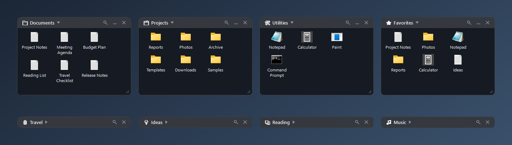
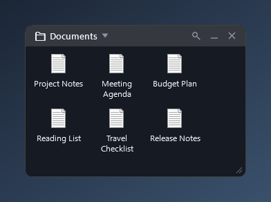
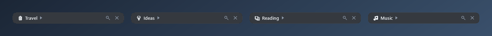
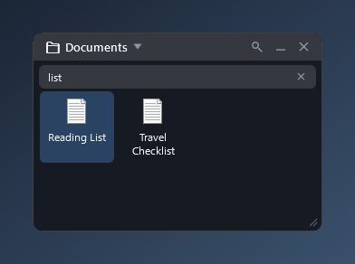

# NextMind Desktop

**A lightweight, local-first desktop organizer for Windows.**

[](https://github.com/NextMindHQ/nextmind-desktop/releases/latest)
[](#requirements)
[](LICENSE)
[](https://github.com/NextMindHQ/nextmind-desktop/actions/workflows/ci.yml)

NextMind Desktop puts collapsible **Zones** directly on your Windows desktop — above the wallpaper and icons, below every
application — so you can group shortcuts, files and folders without opening another window. It is a small tray application:
no account, no cloud, no telemetry.

**[⬇ Download the latest release](https://github.com/NextMindHQ/nextmind-desktop/releases/latest)**



<sub>Zones on a neutral backdrop with synthetic sample data (screenshots never show a real desktop — see [docs/SCREENSHOT-PLAN.md](docs/SCREENSHOT-PLAN.md)).</sub>

## Download / Quick Start

1. Download **`NextMind-Desktop-v0.1.0-win-x64.zip`** from the [latest release](https://github.com/NextMindHQ/nextmind-desktop/releases/latest).
2. Extract it to a folder you want to keep (the app registers that location for *Start with Windows*).
3. Run **`NextMindDesktop.exe`**.

A first Zone appears on your desktop and a tray icon is added. Drop files, folders or shortcuts onto the Zone.

> **Note:** features marked **(v0.2)** below are in development and will ship with the next release. The download linked above is v0.1.0
> and does not include them yet. See the [changelog](CHANGELOG.md).

* **Self-contained:** v0.1.0 includes everything it needs. **You do not need to install .NET.**
* **Not code-signed yet:** Windows SmartScreen may warn about an unrecognized app. If you trust the download, choose *More info* → *Run anyway*.
  You can check the file first: the release includes a `.sha256` file, or run
  `Get-FileHash .\NextMind-Desktop-v0.1.0-win-x64.zip -Algorithm SHA256` in PowerShell and compare it with the value on the release page.
* **Start with Windows is on by default** on the first run. Untick it in the tray menu if you don't want it.
* **Uninstall:** untick *Start with Windows* in the tray menu, choose *Exit*, then delete the folder you extracted the program to.
  Your data folder `%LOCALAPPDATA%\NextMind\Desktop` needs one more step first — see the warning below.

> **Warning — check before you delete `%LOCALAPPDATA%\NextMind\Desktop`.** If you ever turned on *Managed Desktop Moves*, the Desktop items you dropped onto a Zone were
> **moved** into `%LOCALAPPDATA%\NextMind\Desktop\ManagedItems`, so that folder can hold **your own files**, and the Desktop no longer has them.
> Give them back first: use *Return to Desktop* in each item's menu, or *Delete Zone* → *Return items to Desktop and delete Zone*. Then open `ManagedItems` and make sure it is
> empty or holds nothing you need. Only then delete the data folder (settings, logs and the journal). If you never enabled Managed Desktop Moves (the default), the folder holds only
> settings and logs and can be removed after you exit the app.

## Features

* **Desktop Zones** — named panels that live on the desktop itself, under your windows and over the icons
* **You decide the layout** — no grid and no automatic arranging: drag zones anywhere, overlap them if you like. New zones appear in a free spot **(v0.2)**
  and edges snap to neighbours while you drag (hold **Alt** to move freely) **(v0.2)**
* **Collapse / expand** — double-click the title bar (a collapsed zone is just its title). A zone opens downward, or upward when that covers fewer
  other zones or would leave the screen; other zones are never moved **(v0.2)**
* **Move and resize** — drag the title bar, resize from the edges and corner grip; zones stay within the visible monitor area
* **Search in a zone** — a magnifier in every zone filters its items as you type (names of files, folders and shortcuts; ignores case and Polish letters) **(v0.2)**
* **Drag & drop** — drop files, folders and shortcuts from Explorer or the Desktop onto a Zone
* **Sorting and manual ordering** — drag to reorder, or sort per zone by name, date added or type
* **Show desktop (Win+D)** — zones are part of the desktop layer, so *Show desktop* reveals them; application windows cover them
* **Tidy menus** — context menus and their submenus open where they cover the least of neighbouring zones, and close when you click elsewhere **(v0.2)**
* **Native Windows icons** — the same icons Explorer shows
* **Start with Windows** — toggled from the tray menu
* **Tray icon and Control Center** — create, show/hide and manage zones
* **Persistence** — positions, sizes, collapsed state, items and sort order survive restarts
* **Local-first** — no account, no cloud, no telemetry; the source contains no networking code
* **Managed Desktop Moves** — *opt-in, off by default*; see [below](#managed-desktop-moves--safety)

## Using Zones

### Create and arrange zones

* **Create a zone:** right-click the tray icon → **Create Zone**, or use the Control Center (double-click the tray icon). Give it any name, emoji included.
  A new zone appears in a free spot on the desktop **(v0.2)**.
* **Place it where you want:** drag the title bar. There is no grid and nothing is arranged for you. While you drag, edges snap to neighbouring zones and to
  the screen edge **(v0.2)**; hold **Alt** to move without snapping. You may overlap zones on purpose. Positions are saved automatically and come back after a restart.
* **Resize** from the right and bottom edges or the corner grip.
* **Rename, hide or delete:** right-click the title bar (*Rename Zone*, *Hide Zone*, *Delete Zone*). Deleting a zone never deletes your files.

### Collapse and expand

Double-click the title bar, click the ▼ / ▶ arrow, or use the **—** button to collapse a zone to its title; it stays exactly where you left it, also after a restart.
Expanding opens the zone downward — or upward when that would cover other zones or leave the screen **(v0.2)**. Other zones are never moved, and collapsing a zone
that opened upward puts its title bar back where it was.





### Add items

Drag files, folders and shortcuts onto a zone from Explorer or the Desktop (see [How it works](#how-it-works)). Double-click an item to open it; right-click it for
*Open*, *Show in Explorer*, *Move to Zone* and *Remove from Zone* (which only forgets the path).
Drag items inside a zone to reorder them, drag them onto another zone to move them there, or sort a zone from its title-bar menu (*Sort by* name, date added or type).

### Search in a zone **(v0.2)**

Click the magnifier in the zone's title bar (on a collapsed zone it expands first). Type to filter **that zone's** items as you type; clear the box to see them all again.



* Matches the names of files, folders and shortcuts, **ignoring case and diacritics** (`lodz` finds *Łódź*); with several words, every word must match.
* The zone's own order is kept. Searching never changes the zone, your files or their order.
* If nothing matches you see *No matches for …*.

| Key | Action |
|---|---|
| **↓ / ↑** | Select the next / previous result |
| **Enter** | Open the selected result (or the first match) |
| **Esc** | Clear the text; press again to close the search bar |
| **✕** in the field | Clear the text |
| Click the magnifier again | Close the search bar |

While a filter is active, dragging items to reorder them is switched off; dropping something on the zone shows the whole list again first.
Zones are normally not "active" windows, so they never take the keyboard from your applications — the search box takes it only while you are typing and
gives it back when you close the bar, collapse the zone or switch to another window.

### Show desktop (Win+D)

Zones are part of the desktop layer: they sit above the wallpaper and icons but **below every application window**. *Show desktop* (**Win+D**) or minimizing windows
reveals them; opening an application covers them again. They never float over your applications.

### Menus

Right-click a title bar or an item. Menus and the *Sort by* / *Move to Zone* submenus open where they cover the least of neighbouring zones and stay on screen **(v0.2)**;
they close when you click elsewhere, switch to another application or press Alt+Tab **(v0.2)**.

### Tray icon and Control Center

The tray icon (right-click) offers **Open NextMind Desktop** (the Control Center), **Show / Hide Zones**, **Create Zone**, **Start with Windows** and **Exit**.
Double-click the icon to open the Control Center: it lists all zones with **Hide / Show** and **Rename** for each, **Create Zone**, the *Start with Windows* checkbox,
**Hide All Zones** / **Show All Zones**, and the current state of the Managed Desktop Moves safety gate. *Exit* closes the app now; it does not change *Start with Windows*.

## How it works

Every item in a Zone is one of two kinds, decided by where it comes from:

| You drop… | Result |
|---|---|
| **Anything that is not directly on your Desktop** (other folders, drives, the Public Desktop, Desktop subfolders) | **Reference.** The Zone remembers the path; the original is never touched. "Remove from Zone" only forgets the path. |
| **A loose item from your Desktop** | Depends on the Managed Desktop Moves setting: **reference** while it is OFF (default), **moved** into managed storage when it is ON. |
| **Return to Desktop** (item menu) | Safely moves a managed item back to the Desktop. |

Your settings and the log live in `%LOCALAPPDATA%\NextMind\Desktop\` (`config.json`, `logs\desktop.log`). The log can contain the names of
files you drop onto a Zone — review it before attaching it to a bug report.

## Managed Desktop Moves / Safety

**Managed Desktop Moves are an opt-in, safety-gated feature in v0.1.0, and they are OFF by default.**
The setting is `managedDesktopMovesEnabled` in `%LOCALAPPDATA%\NextMind\Desktop\config.json` (`false` by default). The Control Center shows its
current state. There is no Settings window yet, so enabling it means editing the file while the app is closed.

* **OFF (default):** a Desktop item dropped on a Zone is added as a **reference only**. Nothing is moved; the item stays on the Desktop.
* **ON:** a Desktop item can be **moved into managed storage** (`%LOCALAPPDATA%\NextMind\Desktop\ManagedItems`), so the Desktop icon really disappears.
  A safety assessment runs first. Ordinary shortcuts and small files and folders move directly; riskier items (programs, large files or folders,
  project-like folders, folders that could not be fully scanned) ask first, defaulting to *Add as Reference*; unsafe items (symlinks, junctions, cloud
  placeholders, system or hidden items) are refused and can only be added as references.

Safeguards, whether or not the feature is on:

* **Write-ahead journal and recovery** — every managed move is journaled first and recovered on the next start if the app stopped midway.
* **Atomic, same-volume moves only** — a single rename; never copy-and-delete, never overwrite.
* **Collision handling** — a taken name gets a new one such as `NAME (2).lnk`; nothing is silently overwritten.
* **Delete Zone returns managed items** — the dialog offers *Return items to Desktop and delete Zone* or *Cancel*; no option deletes your files.
* **No delete APIs on user data** — a test fails the build if product code gains a file-delete call.
* **Drops use link semantics** — Explorer is never told to "move" the source, so it cannot delete anything by itself.
* **Fail closed** — if an operation cannot be shown to be safe, it is refused with a message.

Full details: [docs/THREAT-AND-DATA-SAFETY.md](docs/THREAT-AND-DATA-SAFETY.md).

**Known limitations**

* Dragging a managed item *out* to the Desktop is not implemented yet — use **Return to Desktop**.
* Managed storage lives under `%LOCALAPPDATA%`; a tool that cleans AppData could remove it. Keep this in mind before enabling managed moves.
* Keeping a Zone above the desktop icons relies on undocumented Windows behaviour. There is a visible fallback, but a future Windows update could change it.
* Scanning very large folders for reparse points is bounded; when a scan is truncated the app always asks.
* Search matches names only (not file contents or parent folders) and works inside one zone at a time; there is no global search yet.
* Very large zones (hundreds to 2000 items) take a few seconds to load at start and use noticeably more memory.
* Managing many zones (for example 30 or more) is not comfortable yet; a zone list with find-and-jump in the Control Center is planned.
* No Settings window yet. Windows x64 only. The executable is not code-signed.

## Requirements

**Using NextMind Desktop**

* Windows 10 version 2004 (build 19041) or later, or Windows 11 — **x64**
* Nothing else: the v0.1.0 release ZIP is self-contained (no .NET installation needed)

**Building from source**

* The .NET 8 SDK (`global.json` pins an 8.0.4xx SDK and allows roll-forward to newer 8.0 feature bands)
* Git. Visual Studio 2022, Rider or VS Code are optional.

## Build from Source / Development

```powershell
git clone https://github.com/NextMindHQ/nextmind-desktop.git
cd nextmind-desktop
dotnet restore
dotnet build -c Release
dotnet test -c Release
```

To run your build as **your installed app**, from a stable per-user folder (the "Start with Windows" entry stores the path of the running executable):

```powershell
powershell -ExecutionPolicy Bypass -File tools\start.ps1   # publishes to %LOCALAPPDATA%\NextMind\Desktop\app and starts it
powershell -ExecutionPolicy Bypass -File tools\stop.ps1    # stops it (or use tray -> Exit)
```

**To try changes without touching an installed copy**, use the isolated test instance instead — see [docs/DEVELOPMENT.md](docs/DEVELOPMENT.md).
Do not use `start.ps1` / `stop.ps1` for experiments: they act on the installed app.

Project layout:

```
src/NextMind.Desktop.Core    config (versioned, atomic save, recovery), guarded filesystem, journal, managed items, geometry — no Windows API
src/NextMind.Desktop.Shell   Win32 interop: desktop layer, tray, message window, single instance, monitors, known folders, icons
src/NextMind.Desktop.App     WPF app: zone windows, zone manager, Control Center
tests/NextMind.Desktop.Tests xUnit; filesystem tests run only inside guarded temp directories
docs/                        architecture, safety model, manual test scenarios
tools/                       start / stop / autostart helper scripts, icon generator
```

Further reading: [docs/ARCHITECTURE.md](docs/ARCHITECTURE.md), [docs/THREAT-AND-DATA-SAFETY.md](docs/THREAT-AND-DATA-SAFETY.md),
[docs/MANUAL-TEST.md](docs/MANUAL-TEST.md), [docs/DEVELOPMENT.md](docs/DEVELOPMENT.md), [docs/RELEASE-CHECKLIST.md](docs/RELEASE-CHECKLIST.md),
[CHANGELOG.md](CHANGELOG.md).

**Roadmap** — ideas, no dates and no promises: a zone list with find-and-jump in the Control Center, a Settings window, DPI-aware restore of saved sizes,
faster loading of very large zones, an installer and update path, accessibility, additional Shell integration.

## Contributing

Contributions are welcome. Please read [CONTRIBUTING.md](CONTRIBUTING.md) first — especially the filesystem safety rules (never test destructive
operations against a real Desktop) — and the [Code of Conduct](CODE_OF_CONDUCT.md).

## Security

Please report vulnerabilities privately through GitHub (**Security** tab → **Report a vulnerability**). See [SECURITY.md](SECURITY.md).

## License

NextMind Desktop is licensed under the [Apache License 2.0](LICENSE). Copyright 2026 NextMind.

It is original work. Other desktop-organization tools were studied only as general inspiration for the problem space; no code was copied from them.
